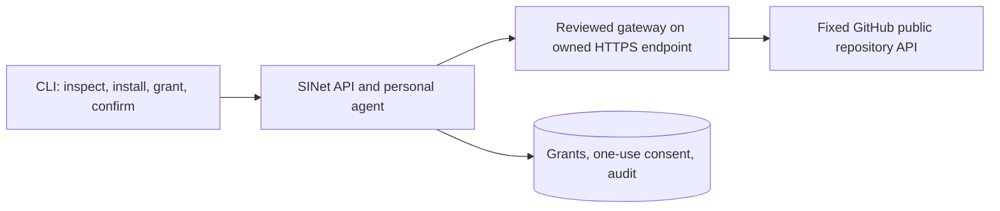

# Next slice: one real connector outcome

Status: local integration complete and tested in **0.2.0-rc.1** source. The live
outcome is blocked on a controlled public HTTPS gateway and independent operator
review. npm/PyPI 0.1.1 are published and unchanged. See the [sprint checklist](GITHUB_SPRINT.md),
[connector guide](GITHUB_CONNECTOR.md), [deployment preparation](GITHUB_DEPLOYMENT.md)
and [evidence ledger](releases/0.2.0-rc.1-validation.md).

## Outcome and boundaries

A signed-in user installs a reviewed, pinned public GitHub repository connector, grants
one operation, sees precisely what will leave SINet, confirms once, and asks their personal
agent to fetch the public SINet repository's metadata. They receive a bounded, attributed
result and an audit entry. Revoking the grant immediately prevents subsequent calls.

Choose public repository metadata for the first real service: it is useful to connector
creators, needs no GitHub user token, and makes permission/disclosure behavior observable.
Start with an operator allowlist containing only `ao3575911/sinet`. Widen that allowlist
only after review. Private repositories, OAuth, repository writes, arbitrary URLs, shell
commands, background autonomy and automatic model tool execution are outside this slice.

The current remote connector protocol POSTs arguments to a fixed HTTPS endpoint plus an
operation name. GitHub's REST API does not implement that protocol. Use a small separately
deployed, reviewed Go gateway; retain the existing registry/grant/consent/SSRF boundaries.
Do not point the current remote adapter directly at GitHub and pretend it is compatible.

## Fixed operation contract

Connector ID: `github-public`; initial connector version: `1.0.0`.
Operation: `repository_summary`; risk: `external_disclosure`, including for read-only data.
Input: exactly `owner` and `repository`, initially the two allowlisted values. Reject extra
fields, credentials, user-supplied hosts, path traversal, encoded separators and oversized
values. Keep the approved gateway host and GitHub host fixed outside user arguments.

Output: canonical repository name, public web URL, nullable description, primary language,
star/fork/open-issue counts, archived flag and upstream updated timestamp. Clarify that
GitHub's open-issue count includes pull requests. These are upstream facts, not model
summaries or live service-health claims. Validate types, lengths, numeric ranges and public
status; reject control characters in displayed text and unknown/unbounded response fields.

Disclosure identifies the gateway and GitHub, the two input fields and the read-only purpose.
Forward no SINet session, email, notes, profile, model history or provider secrets. Tool output
remains untrusted data and cannot grant permissions or trigger another operation. An LLM is
optional and must not be required for the deterministic connector outcome.

## Sprint delivery state

Distribution of 0.1.1, the standalone gateway, fixed schemas and wallet/email source
features were already incorporated in origin/main. This sprint completes the existing
registry/grant/consent/adapter/agent/audit path with both-recipient disclosure, fixed
CLI/TUI invocation, strict gateway result validation and bounded useful failures.
Counted two-account fixtures cover authorization, revocation concurrency, failures and
isolation; existing egress defenses remain enforced. The container and operator guide
are prepared. No live manifest exists because no controlled hostname is known.

Next: provision owned HTTPS hosting, verify its ownership/TLS/operational controls,
submit the actual immutable manifest for separate operator review, then record the
real two-account journey against GitHub. The source release candidate is reviewable;
no tag, GitHub release, registry publication or public-signup approval is authorized.

## Acceptance gates

| Gate | Required evidence |
| --- | --- |
| Real outcome | Fresh account gets public repository facts through the agent and approved HTTPS gateway |
| Default deny | No grant, wrong account/version/operation, and missing consent make zero upstream calls |
| Consent | Expired, replayed and changed-input confirmations fail; disclosure names both recipients |
| Revocation | Uninstall/revoke blocks the next call; concurrent revoke behavior is explicitly tested |
| Isolation | No tokens/private account fields reach the gateway, GitHub, logs or connector output |
| Egress | Private/mixed DNS, DNS rebinding, connected-IP mismatch, redirects and arbitrary URLs fail |
| Untrusted data | Prompt-like descriptions, terminal controls and malformed JSON cannot execute actions |
| Failure handling | Rate limits, timeouts, oversize and upstream errors are bounded, truthful and audited |
| Operations | Verified hostname/TLS, quotas, monitoring, backup/restore and rollback commands documented |
| Delivery | Signed commits, passing checks, accurate README and command evidence; release tags/publication deferred |

Existing independent security, production hosting/mail/model, real-connector, load/restore
and native-client gates remain issues #2–#6. This slice advances #4; it does not close the
other launch gates or authorize public signup. Marketplace listing follows npm/PyPI and
requires a useful tested Action plus the owner's listing setup (issue #14).
