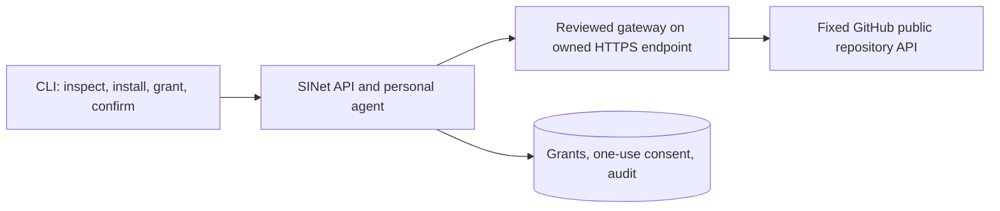

# Next slice: one real connector outcome

Status: preparation only; no live GitHub connector is approved or deployed. Target application
version: **0.2.0**, after the 0.1.1 CLI distribution work. npm/npx and pip packaging are a
separate delivery step and do not imply this connector already works.

## Outcome and boundaries

A signed-in user installs a reviewed, pinned public GitHub repository connector, grants
one operation, sees precisely what will leave SINet, confirms once, and asks their personal
agent to fetch the public SINet repository's metadata. They receive a bounded, attributed
result and an audit entry. Revoking the grant immediately prevents subsequent calls.

Choose public repository metadata for the first real service: it is useful to connector
creators, needs no GitHub user token, and makes permission/disclosure behavior observable.
Start with an operator allowlist containing only `ao3575911/sinet`. Widen that allowlist
only after review. Private repositories, OAuth, repository writes, arbitrary URLs, shell
commands, background autonomy and automatic model tool execution are outside this slice.

The current remote connector protocol POSTs arguments to a fixed HTTPS endpoint plus an
operation name. GitHub's REST API does not implement that protocol. Use a small separately
deployed, reviewed Go gateway; retain the existing registry/grant/consent/SSRF boundaries.
Do not point the current remote adapter directly at GitHub and pretend it is compatible.

## Proposed operation contract

Connector ID: `github-public`; initial connector version: `1.0.0`.
Operation: `repository_summary`; risk: `external_disclosure`, including for read-only data.
Input: exactly `owner` and `repository`, initially the two allowlisted values. Reject extra
fields, credentials, user-supplied hosts, path traversal, encoded separators and oversized
values. Keep the approved gateway host and GitHub host fixed outside user arguments.

Output: canonical repository name, public web URL, nullable description, primary language,
star/fork/open-issue counts, archived flag and upstream updated timestamp. Clarify that
GitHub's open-issue count includes pull requests. These are upstream facts, not model
summaries or live service-health claims. Validate types, lengths, numeric ranges and public
status; reject control characters in displayed text and unknown/unbounded response fields.

Disclosure identifies the gateway and GitHub, the two input fields and the read-only purpose.
Forward no SINet session, email, notes, profile, model history or provider secrets. Tool output
remains untrusted data and cannot grant permissions or trigger another operation. An LLM is
optional and must not be required for the deterministic connector outcome.

## Step-by-step preparation and implementation

1. **Finish distribution first.** Package the existing verified 0.1.1 Go CLI for
   `@ao3575911/sinet` (npm/npx) and `sinet-cli` (PyPI/pip). Test real installs, version/help,
   platform selection, checksums and tamper rejection. Publish only with owner-controlled
   registry access. Keep this preparation on its signed branch; merge/push main after
   registry publication is independently checked, as requested by the owner.
2. **Freeze fixtures and contract.** Capture a public response as a clearly dated fixture;
   add malformed, rate-limited, oversized, private and hostile-text fixtures. Record the
   reviewed operation schema and disclosure copy before adding a manifest to the registry.
3. **Implement the gateway independently.** Proposed paths: `cmd/connector-github` and
   `internal/githubconnector`. Use Go standard library and the existing outbound security
   primitives. Permit only the allowlisted repository and fixed GitHub endpoint, bounded
   time/response sizes and TLS. Disable redirects and proxies; reject non-public DNS/peer IPs.
   Map GitHub 404/403/429/timeouts honestly; never substitute a canned success.
4. **Review and deploy the endpoint.** An operator must supply a controlled public hostname,
   HTTPS on 443, ownership evidence, TLS termination, egress policy and service budget. Run
   non-root with read-only filesystem, dropped capabilities and no host mounts/Docker socket.
   Until this exists, live approval is blocked; local fixtures are not live-service evidence.
5. **Connect the existing trust path.** Submit the immutable manifest for review, verify its
   endpoint ownership, approve it, and exercise install → exact-operation grant → one-use
   disclosure confirmation → agent invocation → audit. Preserve account/version/input-bound
   confirmation, server-side authorization and immediate revocation. No runtime schema
   change or permission broadening is currently proposed.
6. **Validate and document the live journey.** Use two accounts and a counted gateway
   upstream to prove allowed and denied requests. Run the existing race/integration,
   CLI/SMTP/PTY and vulnerability checks. Capture command transcript, migration state,
   redacted audit evidence and upstream limitations; then prepare signed 0.2.0 release notes.

## Acceptance gates

| Gate | Required evidence |
| --- | --- |
| Real outcome | Fresh account gets public repository facts through the agent and approved HTTPS gateway |
| Default deny | No grant, wrong account/version/operation, and missing consent make zero upstream calls |
| Consent | Expired, replayed and changed-input confirmations fail; disclosure names both recipients |
| Revocation | Uninstall/revoke blocks the next call; concurrent revoke behavior is explicitly tested |
| Isolation | No tokens/private account fields reach the gateway, GitHub, logs or connector output |
| Egress | Private/mixed DNS, DNS rebinding, connected-IP mismatch, redirects and arbitrary URLs fail |
| Untrusted data | Prompt-like descriptions, terminal controls and malformed JSON cannot execute actions |
| Failure handling | Rate limits, timeouts, oversize and upstream errors are bounded, truthful and audited |
| Operations | Verified hostname/TLS, quotas, monitoring, backup/restore and rollback commands documented |
| Delivery | Signed commits/tag, passing checks, accurate README and an actual command transcript |

Existing independent security, production hosting/mail/model, real-connector, load/restore
and native-client gates remain issues #2–#6. This slice advances #4; it does not close the
other launch gates or authorize public signup. Marketplace listing follows npm/PyPI and
requires a useful tested Action plus the owner's listing setup (issue #14).
